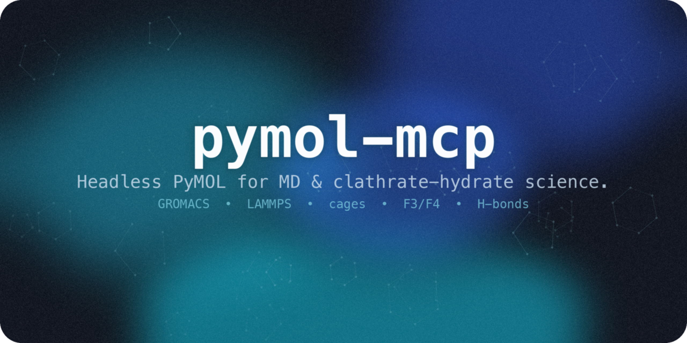
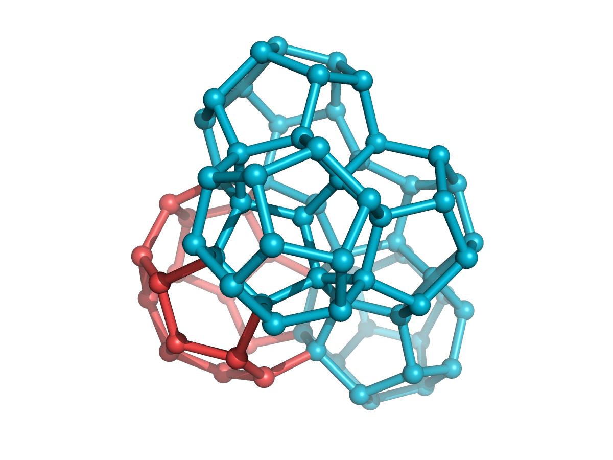

<p align="center"></p>

<h1 align="center">pymol-mcp</h1>
<p align="center">
  <em>헤드리스 PyMOL을 MCP 서버로 — 분자 시각화, GROMACS/LAMMPS 궤적, 클라스레이트 하이드레이트 케이지 분석을 LLM에서 직접 구동하세요.</em>
</p>
<p align="center">
  <a href="#데모">데모</a> · <a href="#빠른-시작">빠른 시작</a> · <a href="#핵심-요약">핵심 요약</a> · <a href="#기능">기능</a> · <a href="#도구-카탈로그">도구</a> · <a href="#도메인-클라스레이트-하이드레이트-과학">케이지 과학</a> · <a href="./README.md">English</a>
</p>
<p align="center">
  
  
  
  
  
  <a href="https://glama.ai/mcp/servers/wjgoarxiv/pymol-mcp"></a>
</p>

---

> [!NOTE]
> **PyMOL을 프로세스 안에서 헤드리스로** 구동하는 MCP 서버입니다 — GUI도, 소켓 플러그인도, 수동 설정도 없습니다.
> **타입이 지정된** 도구 30개 이상을 제공하고, 렌더링한 **이미지를 그대로 인라인으로 반환**해 모델이 자신이 그린 결과를 눈으로 확인할 수 있습니다.
> **GROMACS/LAMMPS** 궤적을 읽어 들이고, **수치적으로 검증된** 클라스레이트 하이드레이트 분석 도구
> (수소결합 네트워크, F3/F4 오더 파라미터)까지 갖췄습니다.

## 데모

<p align="center"></p>
<p align="center"><em>자연어로 요청 → 모델이 타입 지정 도구를 호출 → 헤드리스 PyMOL이 렌더링. (<a href="./assets/pymol-mcp-demo.mp4">고화질 MP4</a>)</em></p>

## 핵심 요약

| | |
|---|---|
| **런타임** | 임베드 **헤드리스** `pymol2` — GUI/플러그인/소켓 없음 |
| **도구** | 실제 구조화된 반환값을 갖는 **30개 이상의 타입 지정 도구** |
| **비전** | 레이트레이싱 PNG를 **인라인 반환**하여 모델이 그린 결과를 직접 확인 |
| **MD 궤적** | GROMACS `.xtc/.trr` + LAMMPS 덤프 (MDAnalysis 브리지) |
| **도메인 과학** | 케이지 인식(TRACE), 점유율, 수소결합, F3/F4 — **검증됨** |
| **견고성** | 워커 스레드 세션, **stdout 안전** 전송, pytest 스위트 |
| **안전성** | 임의 코드 실행 패스스루 **기본 꺼짐** |
| **디렉터리** | [Glama](https://glama.ai/mcp/servers/wjgoarxiv/pymol-mcp) (`wjgoarxiv/pymol-mcp`, 릴리스 v0.1.0) 및 [awesome-mcp-servers](https://github.com/punkpeye/awesome-mcp-servers) Biology ([PR #9110](https://github.com/punkpeye/awesome-mcp-servers/pull/9110), 머지됨) |

## 기능

- **임베드 & 헤드리스** — 전용 워커 스레드에서 단일 PyMOL 인스턴스를 유지; 클릭할 것이 없고 CI에서도 동작.
- **모델이 *볼 수* 있음** — `render_image`가 레이트레이싱한 PNG를 MCP 이미지 콘텐츠로 반환합니다. PyMOLWiki의 양자화 색상·윤곽선 프로필에는 `ray_style="pymolwiki_color"`를 사용합니다.
- **MD 네이티브** — GROMACS `.gro`+`.xtc`를 바로 읽고, LAMMPS/NetCDF는 MDAnalysis로 좌표를 메모리에 직접 주입해 연결.
- **클라스레이트 하이드레이트 도구** — 검증된 Rust 엔진에서 이식한 수소결합 네트워크와 **F3/F4** 오더 파라미터. 모든 계산은 nm 단위로, 삼사정계 PBC까지 정확히 처리.
- **타입 지정, 안전한 도구** — 모든 인자가 스키마로 검증됨; 임의 코드 실행은 **옵트인**(`PYMOL_MCP_ALLOW_CODE_EXEC=1`).
- **프로토콜 안전** — PyMOL이 stdout으로 쏟아내는 출력을 영구 리다이렉트해 JSON-RPC 스트림을 절대 오염시키지 않음(서브프로세스 테스트로 증명).

## 빠른 시작

> [!IMPORTANT]
> PyMOL 오픈소스는 **conda** 패키지이며, 서버는 `import pymol2`가 가능한 파이썬에서 실행되어야 합니다.
> 해당 인터프리터에 설치하세요 — `uvx`/`fastmcp install`은 PyMOL이 없는 격리 환경을 만들므로 사용하지 **마세요**.

```bash
# 1. 환경 생성 (또는 pymol-open-source가 이미 있는 환경 재사용)
conda env create -f env.yml        # `pymol-mcp` 환경
conda activate pymol-mcp

# 2. 패키지 설치 (MD 브리지 + 개발 도구 포함)
pip install -e ".[md,dev]"

# 3. 검증
pytest -q
```

**stdio 기반 표준 MCP 서버**이므로 MCP를 지원하는 모든 클라이언트에서 사용할 수 있습니다
(Claude Code / Desktop, Codex CLI, Gemini CLI, Cline, Continue 등). `import pymol2`가 가능하도록
command를 **절대 경로** conda 인터프리터로 지정하세요.

대부분의 클라이언트는 `mcpServers` 블록을 사용합니다 (Claude Code / Desktop, Gemini CLI, Cline, Continue 등):

```json
{
  "mcpServers": {
    "pymol": {
      "command": "/절대/경로/conda/envs/pymol-mcp/bin/python",
      "args": ["-m", "pymol_mcp"]
    }
  }
}
```

<details>
<summary><b>Codex CLI</b> — <code>~/.codex/config.toml</code></summary>

```toml
[mcp_servers.pymol]
command = "/절대/경로/conda/envs/pymol-mcp/bin/python"
args = ["-m", "pymol_mcp"]
```
</details>

옵트인 스크립팅 도구를 켜려면 서버 항목에 `"env": {"PYMOL_MCP_ALLOW_CODE_EXEC": "1"}`을 추가하세요.

이후 에이전트에게 이렇게 요청하세요:

```
./hydrate.gro 를 로드하고, 물을 F4 오더 파라미터로 색칠한 뒤 렌더링해줘.
md.gro + traj.xtc 를 로드하고, CO2 게스트를 구로 표시한 뒤 50번째 프레임을 렌더링해줘.
이 구조에서 물의 평균 수소결합 배위수는 얼마야?
tests/fixtures/hydrate_sII.gro 를 로드하고 케이지를 찾아 그린 뒤, 물은 숨기고 직교 투영으로 렌더링해줘.
```

## 도구 카탈로그

| 그룹 | 도구 |
|-------|-------|
| **세션 / IO** | `load_structure` · `fetch_pdb` · `list_objects` · `get_object_info` · `reset_session` |
| **선택** | `select` · `get_selection_info` |
| **표현** | `show` · `hide` · `color` · `spectrum` · `set_background` |
| **뷰 / 렌더** | `orient` · `zoom` · `turn` · `set_projection` · `render_image` → 🖼️ 인라인 PNG |
| **측정** | `measure_distance` · `measure_angle` · `measure_dihedral` · `align` · `save_file` |
| **궤적 / MD** | `load_trajectory` (GROMACS/DCD) · `load_trajectory_mda` (LAMMPS/NetCDF, MDAnalysis) |
| **클라스레이트 도메인** | `identify_cages` (TRACE) · `cage_occupancy` · `mark_cages` · `hbond_network` · `order_parameter` (F3 / F4) · `chill_plus` · `mark_chill_plus` |
| **스크립팅 (옵트인)** | `run_pml` · `run_python` |

### PyMOLWiki Ray 스타일

`render_image`는 고정된 `ray_style` 프로필을 지원합니다. 생략하면 `pymolwiki_outline`을 사용합니다.
현재 PyMOL 설정을 유지하려면 `ray_style="default"`를 명시하세요.

| 프로필 | PyMOL 설정 | 용도 |
|---|---:|---|
| `default` | 변경 없음 | 현재 장면 스타일 유지 |
| `pymolwiki_outline` | `ray_trace_mode=1` | 색상과 검은 윤곽선 |
| `pymolwiki_bw` | `ray_trace_mode=2` | 흑백 윤곽선 모드 |
| `pymolwiki_color` | `ray_trace_mode=3` | 양자화 색상과 검은 윤곽선 |

PyMOLWiki 프로필은 안티앨리어싱을 2로 설정합니다. 기본 PyMOL 레이트레이서를 사용합니다.
렌더링이 끝나면 이전 레이트레이싱 설정을 복원합니다. PyMOLWiki 예시와 가장 비슷한 결과에는 흰색 배경을 사용하세요.

`set_projection`은 카메라를 **직교**(평행한 케이지 변, 논문용 격자)와 **원근** 사이로 바꿉니다. PyMOL 기본 시야각은 20°이며, 깊이감을 분명히 하려면 40 정도로 올리면 됩니다. `save_file`은 PNG/PDB/PSE를 디스크에 쓰고 없는 상위 폴더를 만듭니다. `list_objects`는 `cages`, `chill_plus` 같은 CGO 오버레이도 포함합니다.

```json
{
  "selection": "all",
  "width": 1600,
  "height": 1200,
  "ray_style": "pymolwiki_color"
}
```

## 도메인: 클라스레이트 하이드레이트 과학

검증된 Rust 레퍼런스 구현에서 이식한 뒤 정답값과 대조해 재검증했습니다. 모든 분석은 **나노미터** 단위이며,
분수좌표 기반 **최소 이미지 규약**(직교·삼사정계 모두), F4용 부호 있는 `atan2` 이면각, 주기 이미지 KDTree 이웃 탐색을 사용합니다.

- **`identify_cages`** — 완전한 TRACE 케이지 인식: 링 탐색 → 기하 검증 → 제약 전파 조립 → 오일러(SEC) 검증 → 면 개수로 유형 분류(5¹², 5¹²6², 5¹²6⁴, …) 및 sI/sII/sH 구조 판정.
- **`cage_occupancy`** — 게스트 분자(CO₂/CH₄)를 케이지에 할당하고 유형별 점유율(θ_S, θ_L) 보고. 게스트는 residue 이름에 `CO2`, `CH4`, 또는 `METH`가 있는 탄소 원자만 인식합니다. 동봉된 `tests/fixtures/hydrate_sI.gro`는 TIP4P 물만 있으므로 점유율은 0입니다.
- **`mark_cages`** — 각 케이지를 **와이어프레임 다면체**(CGO 객체 `cages`)로 그립니다. O–O 변은 실린더, 산소 꼭짓점은 구이며 유형별 색(5¹² 청록, 5¹²6² 보라, 5¹²6⁴ 빨강, 5¹²6⁸ 파랑, 4³5⁶6³ 라임)입니다. 물 객체를 숨긴 뒤 `render_image` 또는 `save_file`을 호출하세요.
- **`mark_cages` 기하 기본값** — 기본 케이지 edge 반지름은 0.18 Å, vertex 반지름은 0.38 Å입니다. `edge_radius` 또는 `vertex_radius`로 재정의할 수 있습니다. `cage_types`로 일부만 그릴 수 있습니다(예: `["5^12 6^8"]`). 주기 경계를 넘는 케이지는 조각처럼 보일 수 있으며, 이는 그리기 한계이지 개수 오류가 아닙니다.
- **`order_parameter`** — F4(비틀림), F3(3체 각도). F4 ≈ 0.7–0.95 → 하이드레이트, ≈ 0 → 액체, ≈ −0.4 → 얼음 Ih.
- **`hbond_network`** — 물 수소결합 그래프 (O–O ≤ 0.36 nm 및 도너 H–O···O 각 < 35°) + 배위 통계.
- **`chill_plus`** — CHILL+ q3 결합 상관 방법으로 각 물을 액체·얼음·하이드레이트로 분류합니다. 6개 클래스별 개수, 물별 클래스, 분율, 고유 O–O 네트워크를 반환합니다. 기본 컷오프는 0.35 nm입니다. `state`는 1부터 시작하는 PyMOL 상태이며 기본값은 1입니다.
- **`mark_chill_plus`** — 비액체 CHILL+ O–O 네트워크를 `chill_plus` 이름의 색상 CGO 오버레이로 그립니다. `render_image`에서 렌더링할 수 있습니다. 같은 `state` 인자를 사용합니다.
- **성능** — `chill_plus`는 스케일을 반영한 기계 정밀도 허용 오차 안의 90° 각도 반올림을 포함한 직교 셀에서 희소 셀 목록을 사용합니다. 기준 MIC 거리 검사를 유지합니다. 실제 기울기가 있는 셀에서는 임시 메모리를 제한한 O(n²) 대체 경로를 사용합니다. 인접 목록과 엣지 결과의 메모리는 엣지 수에 따라 증가합니다. 큰 삼사정계 시스템은 별도 벤치마크가 필요합니다.

<p align="center"><br/><em>검출된 sII 케이지를 와이어프레임 다면체로 시각화: 5¹² 십이면체(청록)가 5¹²6⁴ 케이지(빨강)를 면 공유로 둘러싼 모습.</em></p>

> [!TIP]
> **정답값 대비 검증:** 구조 II 레퍼런스에서 `identify_cages`가 정확히 **128 × 5¹² + 64 × 5¹²6⁴** 케이지(교과서적 2:1 sII 격자)를,
> 구조 I에서 정확히 **16 × 5¹² + 48 × 5¹²6²**를, 구조 H에서 **48 × 5¹² + 32 × 4³5⁶6³ + 16 × 5¹²6⁸**(단위셀 16개)를 찾습니다.
> 첫 10개 물 분자의 F4는 레퍼런스 값 **0.926698**을 정확히 재현하고,
> F3 = 0.0028 (하이드레이트-유사 ≤ 0.04), 수소결합 네트워크는 완벽한 정사면체(평균 배위수 4.00) 골격입니다.

MCP 도구로 돌린 전형적인 케이지 그림 절차:

```
load_structure  tests/fixtures/hydrate_sII.gro  (object sII)
identify_cages  → structure_type sII
mark_cages      → CGO 객체 "cages"
hide            물 표현
set_projection  orthographic   (또는 perspective, field_of_view=40)
set_background  white
render_image    / save_file path.png
reset_session   다음 구조 전에
```

## 동작 원리

```
   MCP 클라이언트 (Claude · Codex · Gemini …)
          │  stdio JSON-RPC
          ▼
 ┌───────────────────────────────────────────────┐
 │  pymol-mcp  (FastMCP, pymol2가 있는 conda 환경)  │
 │   • 영구 stdout 리다이렉트 (프로토콜 안전)         │
 │   • 단일 워커 스레드가 pymol2 소유 + 구동          │
 │   • 타입 지정 @mcp.tool 함수                      │
 └───────────────────────────────────────────────┘
      │ cmd.* (헤드리스)         │ numpy / scipy (nm)
      ▼                          ▼
  PyMOL 3.x  ── ray → PNG    analysis/ (수소결합, F3/F4)
```

## 요구 사항

| 의존성 | 필수 | 용도 |
|-----------|----------|---------|
| Python 3.11+ (conda) | 예 | `import pymol2` 가능한 런타임 |
| `pymol-open-source` 3.x | 예 | 시각화 엔진 (conda) |
| `fastmcp` 3.x, `numpy`, `scipy` | 예 | MCP 서버 + 분석 |
| `MDAnalysis` | 아니오 (`md` extra) | LAMMPS / NetCDF / xtc 브리지 (GPL-2.0+) |
| `ffmpeg` | 아니오 | 동영상 내보내기 (예정) |

## 라이선스

[MIT](./LICENSE). 선택적 `md` extra는 **MDAnalysis**(GPL-2.0-or-later)를 지연 임포트하며, 코어 패키지는 MIT를 유지합니다.
